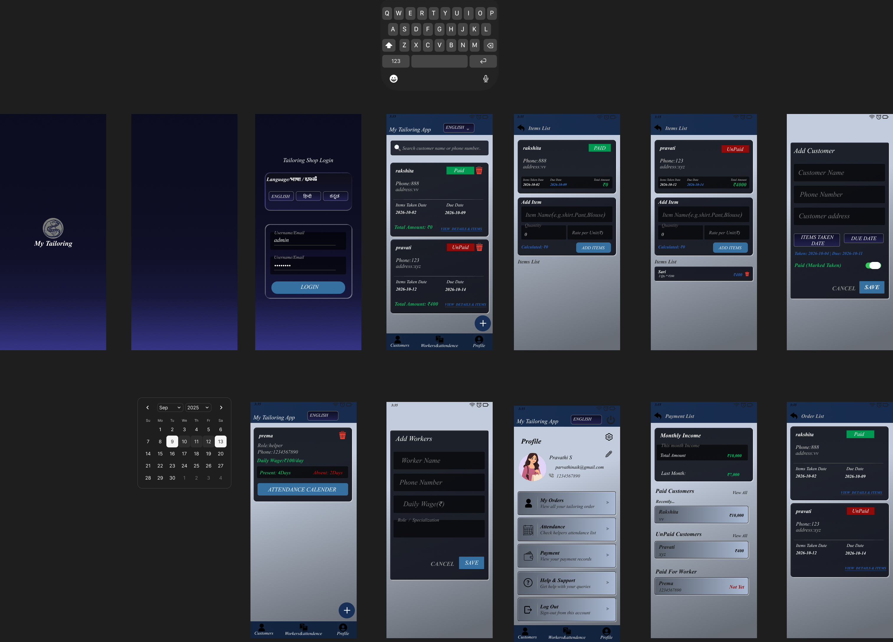
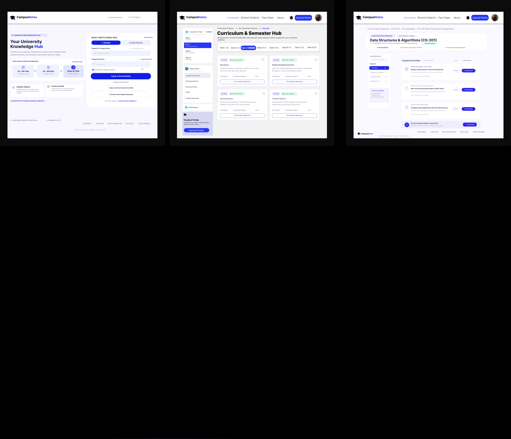

# UI/UX Design Portfolio

Welcome to my UI/UX Design repository!

This repository contains my UI/UX design projects, Figma work, wireframes, prototypes, and some mobile application designs.

## About

I am an Information Science and Engineering student with a growing interest in UI/UX Design. I enjoy creating simple, user-friendly interfaces and exploring design solutions for real-world problems.

## Tools & Skills

- Figma
- Wireframing
- UI Design
- Prototyping
- User Flows
- Components & Auto Layout
- Canva

## Projects

### 1. My Tailoring App

A mobile application concept designed for managing a tailoring business.

**Designed features:**
- Customer management
- Order tracking
- Payment history
- Worker attendance
- Customer profile
- Calendar-based attendance

**Tools:** Figma, Android Studio, Kotlin

### Complete UI Design

### Figma Prototype

--[View My Tailoring App in Figma](https://www.figma.com/design/VtNqsBNoCiHGEic0qaKyFT/My-Tailor?node-id=23-2026&t=Md5A0Ag0MNFyUPgH-1)

### 2. CampusNotes App

A web application concept designed to help college students access and manage academic notes in one place.

**Designed features:**

* Student login
* Semester selection
* Branch and subject selection
* Notes and study materials
* Recently added notes
* Organized academic resources

**Tools:** Figma

### Complete UI Design

### Figma Prototype

--[View CampusNotes in Figma](https://www.figma.com/site/HsLP78sLRdnqSfPG3g0mQT/CampusNotes?node-id=0-1&t=4JCljUGWUWX6pq9d-1)

##  Connect With Me

- GitHub: https://github.com/Rakshita123-prog
- Email: rakshithas.23ise@cambridge.edu.in | nrakshita898@gmail.com
  
